# artificial-analysis-xhigh

Auto-updating links to the [Artificial Analysis](https://artificialanalysis.ai/models) Intelligence
Index chart at `xhigh`, `high` or `medium` effort instead of its default `max`, plus a summary of
the top models at each effort level.

## Links

Bookmark these. Each redirects to the latest chart.

| View | What changes from the default chart | Link |
| --- | --- | --- |
| xhigh | every `max` variant becomes `xhigh` | https://honvl.github.io/artificial-analysis-xhigh/ |
| high | every `max` and `xhigh` variant becomes `high` | https://honvl.github.io/artificial-analysis-xhigh/high/ |
| medium | every `max`, `xhigh` and `high` variant becomes `medium` | https://honvl.github.io/artificial-analysis-xhigh/medium/ |

A model with no variant at that level stays as it is, and models with no effort setting are
untouched. Add `#info` to a link to see which models were swapped instead of redirecting. See
[Add it to your bookmarks](#add-it-to-your-bookmarks) for the easy way to save them.

## Why I made this

Artificial Analysis charts Claude, GPT and other models at their `max` effort by default, and
xhigh is cheaper and faster. Artificial Analysis's own per-task measurements show it for every model
in the default chart that has both variants (snapshot from 2026-10-24, max → xhigh):

| Model | Cost per task | Time per task | Output tokens per task | Intelligence Index |
| --- | --- | --- | --- | --- |
| Claude Opus 5.5 | $5.98 → $3.46 (−42%) | −38% | −45% | 57.6 → 56.0 |
| Claude Sonnet 5.5 | $5.46 → $2.01 (−63%) | −55% | −62% | 56.0 → 51.9 |
| Claude Fable 5.1 | $7.63 → $5.98 (−22%) | −18% | −22% | 53.4 → 53.2 |
| Claude Haiku 5.5 | $0.213 → $0.124 (−42%) | −31% | −45% | 43.4 → 41.2 |
| GPT-6 Astra | $3.26 → $2.31 (−29%) | −35% | −38% | 52.7 → 52.4 |
| GPT-6.1 Sol | $0.724 → $0.393 (−46%) | −50% | −54% | 51.8 → 51.0 |
| GPT-6 Luna | $0.068 → $0.042 (−38%) | −38% | −45% | 38.1 → 34.6 |

xhigh uses 22% to 62% fewer output tokens, which is where the savings come from. The trade-off is a
slightly lower Intelligence Index score, 0.2 to 4.1 points lower in this snapshot. Anthropic's docs
describe `max` as ["absolute maximum capability with no constraints on token spending"](https://platform.claude.com/docs/en/build-with-claude/effort#effort-levels).

The site does show xhigh scores, but you have to pick every model by hand in its model selector.
This repo builds the link that does that for me and keeps it current as the site's default models
change. The high and medium links do the same for lower effort levels.

## Top models at each effort level

The ten highest-scoring models on the Intelligence Index at each effort level, regenerated every
3 hours. Each chart shows a model at the best setting it has at or below that level:

- A model with a variant at the level is shown at that variant.
- Otherwise it is shown at its highest setting below the level, with that setting in brackets. A
  model that only has High, like Gemini 4 Argon, is on the max, xhigh and high charts.
- A model with no labelled effort setting, like Kimi K3.1 Pro, could be anything up to max, so it
  appears only on the max chart, marked with a †.
- A model whose every setting is above the level is left off that chart.

Anthropic (amber), OpenAI (green), Google (blue) and Meta (pink) have their own colors, and every
other lab shares gray. Those four hues are the largest set from the dataviz palette that stays
distinguishable for every pair, including for color-blind readers, so they can't be swapped for
arbitrary brand colors. Table views of the same numbers are on the
[summary page](https://honvl.github.io/artificial-analysis-xhigh/summary.html).

### max (the Artificial Analysis default)



### xhigh



### high



### medium



## How it works

The site picks its default 27 models server-side and accepts an override as
`/models?models=slug1,slug2,...`. Each effort level is its own slug
(`claude-opus-5-5` is Max, `claude-opus-5-5-xhigh` is Xhigh).

`aa_xhigh.py` fetches the page and reads the data the site embeds in it:

1. The default selection (`chartDefaultSelected`), in the site's order.
2. The full variant list, each entry with a `releaseSlug` and an effort label in its name.
3. For every default model labelled above the target level, it finds the sibling with the same
   `releaseSlug`, the same qualifier (e.g. "Default Fallback") and the target label, and
   substitutes it. It never raises a model to a higher level.

A model above the target with no sibling at it (for example GLM-5.3, which only has Max and Low
at the time of writing) stays as it is. Use `--unmatched drop` to remove such models from the
chart instead.

The charts use a second source: the model picker embedded in the site's
`/models/comparisons` page, which lists an Intelligence Index for each variant. `aa_charts.py`
groups the variants of each model by release, applies the rules above to pick one per model for
each chart, and draws the SVGs.

I looked at placing unlabelled models on the lower charts by speed and decided against it: time per
task does not line up with effort across labs. In the 2026-10-24 data, Claude Haiku 5.5 at max
takes 430 s per task while Qwen3.8 27B at xhigh takes 1,227 s, and Kimi K3.1 Pro's 618 s sits
inside the max, xhigh and high ranges at once.

The scheduled workflow re-runs everything every 3 hours and commits `docs/` only when something
changes.

## Setup

Needs a public repo (Pages on private repos needs a paid plan).

```bash
gh repo create artificial-analysis-xhigh --public --source=. --push
gh api -X POST repos/{owner}/artificial-analysis-xhigh/pages -f 'source[branch]=main' -f 'source[path]=/docs'
gh workflow run update-link
```

Or in the web UI: Settings, Pages, deploy from branch `main`, folder `/docs`.

The site then lives at `https://<your-username>.github.io/artificial-analysis-xhigh/`. Each link
folder also has `link.txt` (the raw link) and `latest.json` (details).

## Add it to your bookmarks

The links redirect, so pressing your browser's "bookmark this page" shortcut on one saves the long
chart URL it lands on, which goes stale when the default models change. Instead:

- **Drag (easiest):** open the [bookmark page](https://honvl.github.io/artificial-analysis-xhigh/bookmark.html)
  and drag the links onto your bookmarks bar.
- **Paste the URL:** copy a link from the table above, then in Chrome press Cmd/Ctrl+Shift+O, use
  the menu at the top right, choose Add new bookmark and paste. In Firefox, Cmd/Ctrl+Shift+O,
  Organize, New Bookmark. Safari has no add-by-URL, so use the drag links.

## Use it locally

No dependencies. Developed on Python 3.12.

```bash
python3 aa_xhigh.py                  # print the xhigh link
python3 aa_xhigh.py --level high     # print the high link (xhigh, high, medium, low or minimal)
python3 aa_xhigh.py --explain        # also show what was swapped
python3 aa_xhigh.py --open           # open it in your browser
python3 aa_xhigh.py --unmatched drop
python3 aa_xhigh.py --write docs     # regenerate the whole Pages site: links and charts
```

## Tests

```bash
python3 -m unittest discover -s tests -v
AA_LIVE=1 python3 -m unittest discover -s tests -k Live -v   # also hit the real site
```

## When it breaks

The scripts read data embedded in the site's pages, which is not a public API. If a page changes
shape the script exits with an error (and checks that every slug it emits exists in the site's own
model list) rather than publishing something wrong. The links and the charts come from different
pages, so one failing does not hold back the other. The workflow run turns red, GitHub emails
you, and `docs/` keeps the last good output.

GitHub disables scheduled workflows after 60 days without repo activity, so the workflow adds an
empty keepalive commit when the last commit is older than 50 days.
